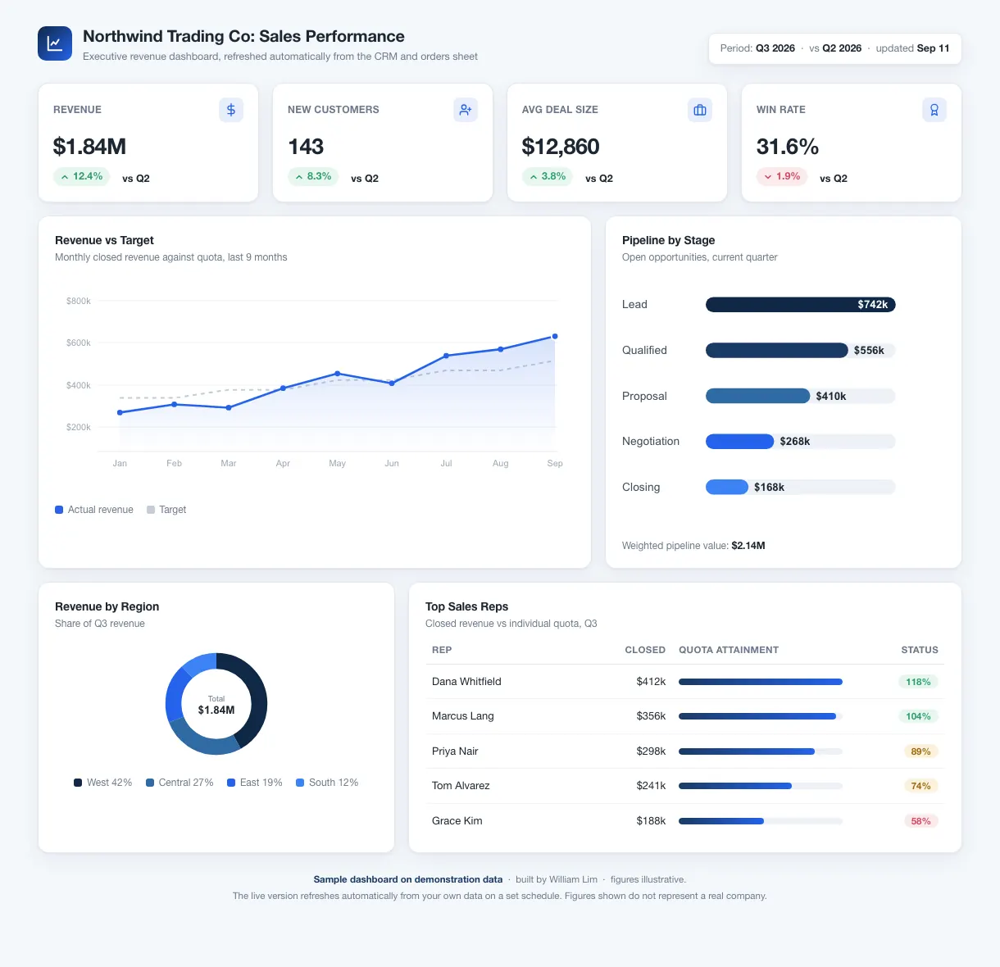
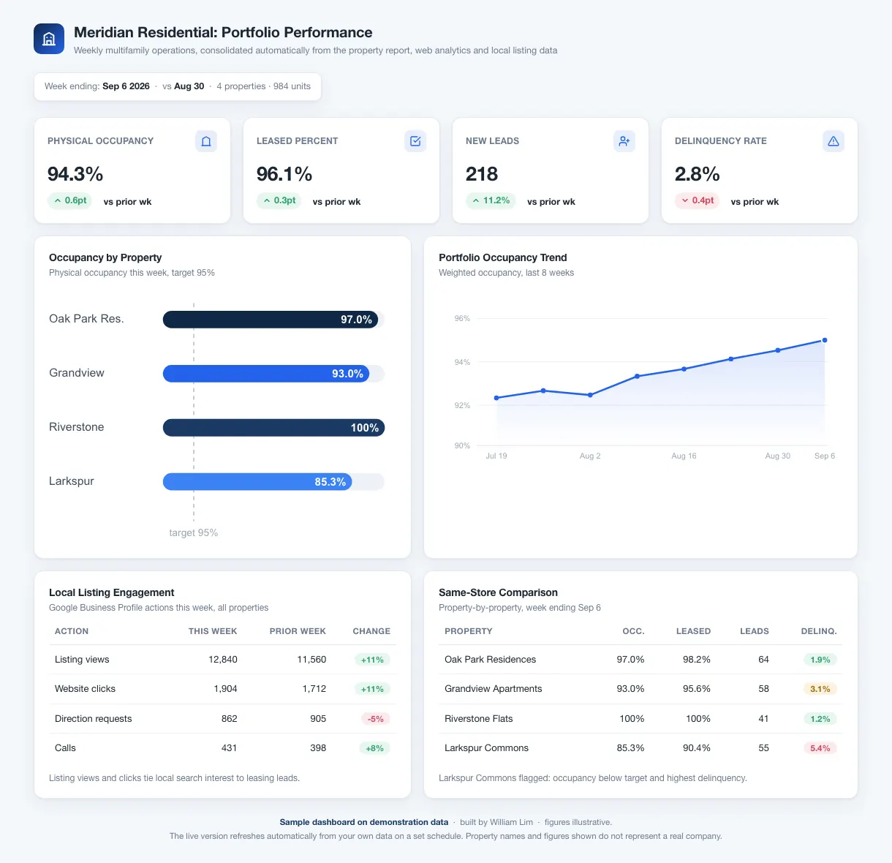
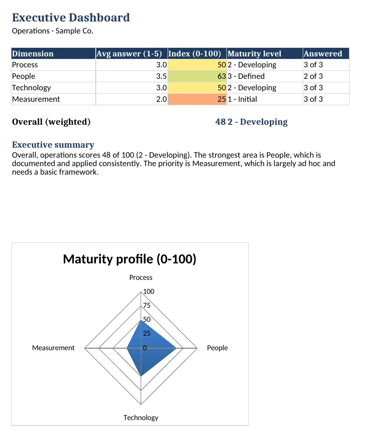
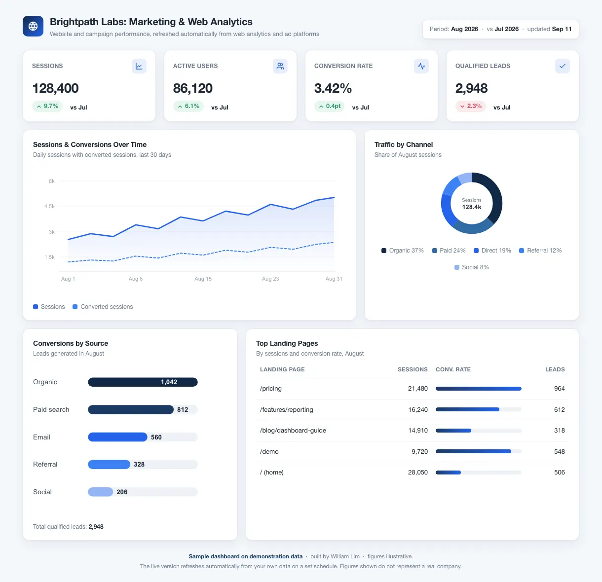
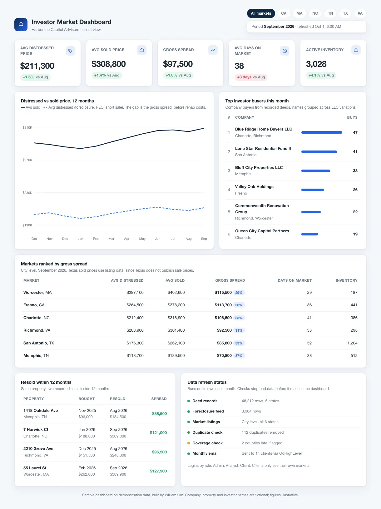
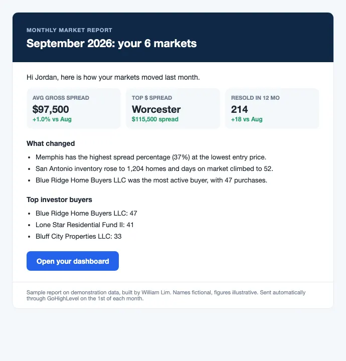

# Sheets and reporting automation: sample work



Spreadsheet systems that replace manual weekly reporting: scheduled imports, formula-driven KPI dashboards and locked scoring templates, built in Google Sheets, Apps Script, Excel and Python.

**More work:** [**wkllabs.com**](https://wkllabs.com)

<p>
  
  &nbsp;
  
</p>

## The problem

Operations teams spend hours each week copying exports into spreadsheets, fixing broken formulas and rebuilding the same charts. Vendor reports change shape without notice, numbers get re-keyed in three places, and nobody trusts the totals.

## What I built

- **Scheduled imports (Apps Script):** a weekly property-operations report parser that finds the header by name instead of position, normalizes drifting property names, reconciles against the report's TOTAL row and refuses to import on a mismatch. GA4 and Google Business Profile metrics merge into the same week on a time trigger. See [`property-reporting/`](property-reporting/).
- **Append-only history with idempotent upserts:** one row per property per week, keyed by week and property, so re-running an import never duplicates data.
- **Review queue and anomaly flags:** anything that cannot be reconciled, plus large week-over-week swings, lands on a Review tab instead of silently reaching the dashboard.
- **KPI dashboards:** formula-driven workbooks and matching single-page HTML previews for sales, marketing analytics, property performance and investor market reporting. See [`dashboards/`](dashboards/).
- **Scoring templates:** a locked assessment workbook with input cells, weighted dimensions, maturity levels, a generated executive summary sentence and a radar chart. See [`assessment-scoring/`](assessment-scoring/).
- **Reproducible builds:** the property and assessment workbooks are generated by Python (openpyxl) scripts, so layout and formulas are versioned like code.

| Marketing analytics | Investor market | Monthly report |
|---|---|---|
|  |  |  |

## Tech

Google Sheets, Google Apps Script (time triggers, LockService, UrlFetchApp, GA4 Data API with a service account), Microsoft Excel, Python with openpyxl, LibreOffice for headless recalculation, HTML and CSS for dashboard previews.

## Results and quality

- Workbooks use plain, portable formulas (SUMIFS, AVERAGEIFS, IFERROR) that work in both Excel and Google Sheets, with no macros.
- The Apps Script import includes built-in self-tests for name matching and reconciliation.
- Inputs are separated from locked calculation cells so non-technical users cannot break the logic.

## Notes

Client work is private; these are sanitized samples on fictional companies, properties and people with illustrative figures. Repository layout:

```
dashboards/           HTML previews and Excel workbooks (sales, marketing, property, investor)
property-reporting/   Apps Script import pipeline, sample workbook, PDF walkthrough, build script
assessment-scoring/   Scoring workbook and its build script
docs/images/          Screenshots rendered from the samples
```
